# EveryInfra Analysis Skills

  <picture>
    <source media="(prefers-color-scheme: dark)" srcset="assets/hero-dark.svg">
    <source media="(prefers-color-scheme: light)" srcset="assets/hero-light.svg">
    
  </picture>

  
  

  
  
  
  

<a href="README.md">English</a> · <b>简体中文</b> · <a href="README.es.md">Español</a>

**免费下载，用你自己的 AI 工具和模型。**

EveryInfra Analysis Skills 的版本为 `0.4.1`，采用 Apache-2.0 许可协议。本软件包可免费下载和安装。它随附**六个**分析 Skill——四个领域 skill 加一个共享的 **analysis-foundation(分析纪律层)**。它不调用模型，不捆绑模型提供商，也没有 API 密钥或运行时依赖。模型和模型配额来自客户自己的兼容 AI 工具。

单独的 EveryInfra 数据采集 API 或 MCP 调用可能产生费用。免费安装 Skill 并不等于免费采集。

## Skills

| Slug | 分析内容 |
| --- | --- |
| `ecommerce-product-analysis` | 产品候选，来自用户提供的 CSV/JSON 或已获取的结果。 |
| `social-content-performance` | 指定样本和时间窗口内的社交内容表现分析，来自所提供的文件或已获取的结果。 |
| `content-analysis-tagging` | 使用用户提供或已约定的分类体系标注的记录。 |
| `spreadsheet-deliverable` | Editable .xlsx workbooks with live formulas (inputs/calculations/outputs separated, recalculation and error scan, built-in checks, assumptions with sources) |
| `analysis-foundation` | **共享纪律层**:四步流水、数字必须由代码算出、分母点名、n<30 不报率、不确定度、因果措辞、图表决策表、方法附注、LLM 打标校准。 |
| `review-insights` | 商品、应用、门店或公司评价中的痛点、好评点和评分分布，来自所提供的文件或已获取的结果。 |

每个 Skill 分析所提供的文件或已获取的结果。安装 Skill 不会采集数据。

## 配合 EveryInfra 数据使用

每个 Skill 也可以分析你已经从 EveryInfra 取回的结果。下表是匹配的 EveryData 能力示例（当前能力和字段以实时目录为准）：

| Skill | EveryData 能力示例 |
| --- | --- |
| `ecommerce-product-analysis` | `amazon/search`、`aliexpress/search`、`taobao/search`、`jd/search`、`shopee/search` |
| `social-content-performance` | `tiktok/search`、`tiktok/user_videos`、`youtube/search`、`xiaohongshu/search`、`bilibili/search` |
| `content-analysis-tagging` | 文本类记录，例如 `xiaohongshu/search`、`reddit/search`、`zhihu/search` 或各平台的 `comments` 结果 |
| `review-insights` | `amazon/reviews`、`walmart/reviews`、`taobao/reviews`、`trustpilot/reviews`、`app_store/reviews`、`google_maps_reviews/reviews` |

实时目录：`GET https://api.everyinfra.com/api/v1/social/catalog`。

## 快速开始

1. 按任务选择 Skill。
2. 下载仓库 ZIP，或克隆 `https://github.com/everyinfra/analysis-skills.git`。将所选 Skill 文件夹安装到兼容宿主文档中说明的 Skill 位置。本 README 列出 `~/.agents/skills/` 和 `~/.claude/skills/`。
3. 在 AI 宿主自己的设置中配置或选择客户自己的模型。本软件包不配置宿主，也不提供模型密钥。
4. 打开对应的合成示例，将示例中的 `source_response` 和任务交给 Skill。示例包含 `expected_output`；比较返回的结构，不要比对模型的具体措辞。此步骤不会发起 EveryInfra 数据采集调用。
5. 如需进行新的数据采集，请参阅现行 API/MCP 文档。采集是单独步骤，可能产生费用。

## 下载

从 GitHub 仓库页面获取仓库源码 ZIP：

1. 打开 [https://github.com/everyinfra/analysis-skills](https://github.com/everyinfra/analysis-skills)。
2. 使用 GitHub **Code** → **Download ZIP**。
3. 解压 ZIP。

也可克隆 `https://github.com/everyinfra/analysis-skills.git`。

## 安装

| 宿主              | 安装目录               |
|-------------------|-----------------------|
|  Codex CLI / IDE   | `~/.agents/skills/`   |
|  Claude Code       | `~/.claude/skills/`   |

将以下一个或多个确切的 Skill 文件夹复制到 `~/.agents/skills/` 或 `~/.claude/skills/`：

- `skills/ecommerce-product-analysis`
- `skills/social-content-performance`
- `skills/content-analysis-tagging`
- `skills/review-insights`
- `skills/spreadsheet-deliverable`

另外把 `skills/analysis-foundation` 一起复制：每个 Skill 都引用这个共享的分析纪律层。兼容宿主可以使用其文档中说明的 Skill 文件夹。

 Codex CLI / IDE: `$ecommerce-product-analysis` · `$social-content-performance` · `$content-analysis-tagging` · `$review-insights`

 Claude Code: `/ecommerce-product-analysis` · `/social-content-performance` · `/content-analysis-tagging` · `/review-insights`

对于合成示例，只向模型提供 `source_response` 和 `task`；保留 `expected_output` 在模型输入之外以便之后比较。

[Build skills —  Codex](https://developers.openai.com/codex/build-skills) · [Extend  Claude with skills](https://code.claude.com/docs/en/skills)

## 合成示例

`examples/` 目录包含四个合成示例，每个 Skill 各一份。它们是合成的：

- `examples/ecommerce-product-analysis.synthetic.json`
- `examples/social-content-performance.synthetic.json`
- `examples/content-analysis-tagging.synthetic.json`
- `examples/review-insights.synthetic.json`

打开对应示例，将示例中的 `source_response` 和任务交给 Skill。每个示例都包含 `expected_output`。比较返回的结构，不要比对模型的具体措辞。使用示例不会发起 EveryInfra 数据采集调用。

## 采集与公开 API

这些 Skill 中的分析不收取 Skill 费用。通过 EveryInfra API 或 MCP 采集是单独步骤，可能产生费用。查阅目录或发现工具并不授予发起付费数据调用的权限。

公开 API 参考：

- [https://api.everyinfra.com/docs](https://api.everyinfra.com/docs)
- [https://api.everyinfra.com/openapi.json](https://api.everyinfra.com/openapi.json)

## 维护与反馈

维护方：EveryInfra（该组织）。

更新触发条件：公开 API 合约或 schema 变更、对 Skill 或示例的已核实更正，或已接受的用户请求。每次更新软件包版本时，先审阅未处理的反馈，再更改 manifest 版本和变更日志。这是事件驱动的人工节奏。

反馈渠道：公开 GitHub Issues，地址为 [https://github.com/everyinfra/analysis-skills/issues](https://github.com/everyinfra/analysis-skills/issues)。请勿发布 API 密钥、凭据、客户私有记录或其他机密数据。

## 许可协议

Apache-2.0。参见 `LICENSE`。
